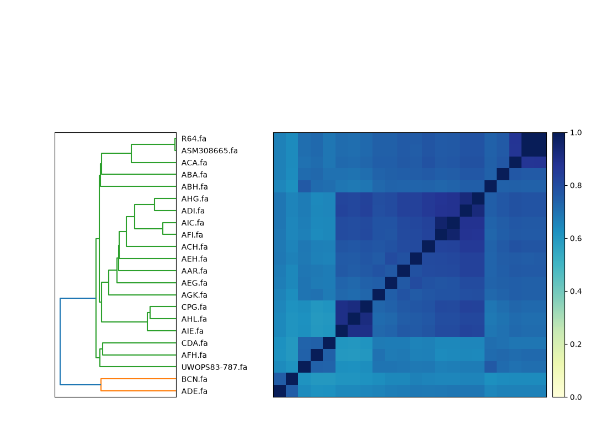

# Practical 3 - Sketching comparisons

Before building alignments, graphs, or indexes, a common first pass on a genome collection is **sketching**: compress each assembly into a compact (generally) k-mer-based summary, then estimate all-pairs relatedness in seconds. That is the same idea behind [Mash](https://github.com/marbl/Mash) (Ondov et al., *Genome Biol* 2016; doi:[10.1186/s13059-016-0997-x](https://doi.org/10.1186/s13059-016-0997-x)). Here we use [sourmash](https://github.com/sourmash-bio/sourmash) (FracMinHash; Irber et al., *JOSS* 2024; doi:[10.21105/joss.06830](https://doi.org/10.21105/joss.06830)) as a Mash-family stand-in, and [dashing2](https://github.com/BenLangmead/dashing2) (Baker & Langmead, *Genome Biol* 2023; doi:[10.1186/s13059-023-02980-3](https://doi.org/10.1186/s13059-023-02980-3)) as a second sketch engine.

Sketch distances are often turned into trees for ordering or visualisation (e.g. ntSynt-viz builds an NJ tree from Mash-like distances). Here that idea shows up as sourmash’s clustered heatmap + dendrogram — not a second tree-building tutorial.

**Collection:** 22 full *S. cerevisiae* assemblies (O'Donnell et al., ScRAP; doi:[10.1038/s41588-023-01459-y](https://doi.org/10.1038/s41588-023-01459-y))

**Docker Image with all the tools pre-installed:** [npmalfoy/scalable:2026](https://hub.docker.com/r/npmalfoy/scalable) (`linux/amd64`)

**Course data (FTP):** [yeast_t2t_haploid.agc](https://ftp.ebi.ac.uk/pub/databases/metagenomics/research-team/shivakumar/scalable_course/yeast_t2t_haploid.agc) (sketching); [athaliana_all.agc](https://ftp.ebi.ac.uk/pub/databases/metagenomics/research-team/shivakumar/scalable_course/athaliana_all.agc) (ModDotPlot + optional Ath20)

> Expected runtimes and memory below are rough guidelines from a dry-run on an Apple Silicon Mac (Docker `linux/amd64`). Your machine may differ. Yeast genomes are small (~12 Mb each), so sketching stays fast; all-pairs still grows as \(O(n^2)\).
>
> Work top to bottom: copy each code block into the container and run it. You should not need to edit anything.

---

## Learning objectives

In this practical you will:

1. Sketch and compare 22 full yeast assemblies with sourmash (`sketch` → `compare` → `plot`)
2. Run an all-pairs dashing2 comparison and inspect the similarity table
3. Re-sketch with a few dashing2 settings (k, sketch size, multiset) and see what moves
4. Open two *A. thaliana* assemblies in [ModDotPlot Browser](https://marbl.github.io/ModDotPlot-Browser/) and explore rearrangements
5. *(Optional)* Sketch 20 geographically diverse *A. thaliana* assemblies and colour the tree by region

---

## 0) Pull the docker container and download the AGC

See the course informatics guide for full setup instructions. Start in a clean working directory, download the yeast AGC, then start an interactive session with that directory mounted at `/course`.

```bash
# from a clean working directory (the one you will mount at /course)
wget -c -O yeast_t2t_haploid.agc \
  https://ftp.ebi.ac.uk/pub/databases/metagenomics/research-team/shivakumar/scalable_course/yeast_t2t_haploid.agc
ls -lh yeast_t2t_haploid.agc
```

**Docker:**

```bash
docker pull npmalfoy/scalable:2026
docker run --rm -it --platform linux/amd64 -v "$PWD:/course" -w /course npmalfoy/scalable:2026
```

**Singularity / Apptainer:**

```bash
apptainer pull scalable.sif docker://npmalfoy/scalable:2026

apptainer shell \
  --bind "$PWD:/course" \
  --pwd /course \
  scalable.sif
```

> Use `singularity` in place of `apptainer` if that is what your cluster provides. On Apple Silicon (or other arm64 hosts), keep `--platform linux/amd64` for Docker. Keep the image entrypoint (do not override with bare `bash -lc`); that is what puts the course tools on `PATH`.

To test that the tools are installed and available:

```bash
which sourmash dashing2 agc
sourmash --version
dashing2 sketch -h | head
```

---

## 1) Extract FASTAs

[AGC](https://github.com/refresh-bio/agc) holds the 22 yeast assemblies. Decompress them into `fastas/`, then rename to short labels so plot axes stay readable (R64, ADI, …).

**Expect:** a few seconds; ~0.3 GB RAM.

```bash
AGC=/course/yeast_t2t_haploid.agc
FASTA_DIR=/course/fastas

mkdir -p "$FASTA_DIR"
agc info "$AGC"
agc listset "$AGC" | head
agc getcol -o "$FASTA_DIR" "$AGC"
ls "$FASTA_DIR"/*.fa | wc -l   # expect 22

# short labels for sourmash / dashing2 / ModDotPlot
for fa in "$FASTA_DIR"/GCA_*.fa; do
  s=$(basename "$fa" .fa \
    | sed -E 's/^GCA_[0-9]+\.[0-9]+_//; s/[.].*//; s/_genomic$//; s/ASM308665v1/ASM308665/; s/CPG_1a/CPG/')
  mv "$fa" "$FASTA_DIR/${s}.fa"
done
ls "$FASTA_DIR"/*.fa | wc -l   # expect 22
ls "$FASTA_DIR" | head
```

---

## 2) sourmash — sketch, compare, plot

[sourmash](https://sourmash.readthedocs.io/) sketches each FASTA (FracMinHash), estimates pairwise Jaccard similarity, then clusters the matrix. The usual workflow is `sketch` → `compare` → `plot`.

**Expect:** a few seconds; ~150–300 MiB RAM.

```bash
cd "$FASTA_DIR"
rm -f /course/yeast.sig.zip   # avoid merging into an old zip if re-running
sourmash sketch dna -p k=31,scaled=1000 -o /course/yeast.sig.zip *.fa
cd /course

sourmash compare yeast.sig.zip -o yeast.cmp --csv yeast.cmp.csv
sourmash plot yeast.cmp --labels --output-dir /course

ls -la yeast.cmp.matrix.png yeast.cmp.dendro.png yeast.cmp.hist.png
```

Open `yeast.cmp.matrix.png` on the host (under your mounted course directory). Which genomes cluster with R64? Which look most distant?

<details>
<summary>Example output (sourmash clustered matrix)</summary>



`sourmash plot` reorders genomes by hierarchical clustering. Cells are **Jaccard similarity** of FracMinHash sketches (1 = identical k-mer content at this `k`/`scaled`; darker blue ≈ closer). The dark diagonal is self-comparison. R64 and ASM308665 are essentially identical (Jaccard ≈ 0.997). ADI sits in the main cluster with R64 (≈ 0.78); AFH is farther (≈ 0.72). Lightest cells vs R64 include BCN and ADE (≈ 0.64–0.66).

</details>

**Checkpoint:** R64 and ASM308665 should be nearly identical (Jaccard ≈ 1). Look for strains that sit farther from the main group on the heatmap / dendrogram (e.g. BCN, ADE, CDA).

---

## 3) dashing2 — default all-pairs

[dashing2](https://github.com/dnbaker/dashing2) can sketch and compare in one step. With `--cmpout`, it writes a human-readable pairwise table (header `#Sources`, upper triangle of similarities, `-` where empty).

**Expect:** under a few seconds; ~50 MiB RAM.

```bash
( cd "$FASTA_DIR" && ls *.fa > /course/fasta.list )

cd "$FASTA_DIR"
dashing2 sketch -k 31 -S 1024 \
  -F /course/fasta.list \
  --cmpout /course/d2_default.phy
cd /course

head -n 5 d2_default.phy

# which column is R64?
awk -F'\t' '/Sources/{for(i=2;i<=NF;i++) if($i ~ /R64/) print i-1, $i}' d2_default.phy

# ADI / AFH rows (similarity to R64 is in the R64 column)
grep -E '^ADI\.fa|^AFH\.fa' d2_default.phy
```

<details>
<summary>Example output (d2_default.phy format)</summary>

```text
#Sources   AAR.fa  ABA.fa  ...  ADI.fa  ...  AFH.fa  ...  R64.fa  ...
ADI.fa     -       -       ...  -       ...  0.65    ...  0.78    ...
AFH.fa     -       -       ...  -       ...  -       ...  0.73    ...
R64.fa     -       -       ...  -       ...  -       ...  -       ...
```

`#Sources` sets column order (here R64 is column 21 of 22). The body is an **upper triangle** of sketch **similarities** in \([0,1]\) (higher = closer); `-` means empty / below the diagonal. R64’s **row** is all `-` — read R64–ADI from the **ADI** row’s R64 column (~0.78) and R64–AFH from the **AFH** row (~0.73). Same relatedness story as sourmash, different estimator.

</details>

---

## 4) dashing2 — try different sketch ideas

Sketch parameters change the estimated similarities. Re-run a few settings and compare the **same pairs** (R64–ADI, R64–AFH).

**Expect:** under a few seconds each for k / sketch-size variants; `--multiset` ~30–40 s and more RAM.

```bash
cd "$FASTA_DIR"

# 1) shorter k — more shared k-mers → similarities usually rise
dashing2 sketch -k 21 -S 1024 \
  -F /course/fasta.list --cmpout /course/d2_k21.phy

# 2) smaller sketch — noisier estimates
dashing2 sketch -k 31 -S 128 \
  -F /course/fasta.list --cmpout /course/d2_S128.phy

# 3) BagMinHash / multiset — uses k-mer counts (often a better match for assemblies)
dashing2 sketch -k 31 -S 1024 --multiset \
  -F /course/fasta.list --cmpout /course/d2_multiset.phy

# optional: Mash/Poisson distance instead of similarity (scale flips: near 0 = close)
dashing2 sketch -k 31 -S 1024 --mash-distance \
  -F /course/fasta.list --cmpout /course/d2_mashdist.phy

cd /course
```

<details>
<summary>Example values (R64–ADI across settings)</summary>

```text
default (k=31, S=1024)   ~0.78   # R64–AFH ~0.73 (AFH lower)
k=21                     ~0.85   # more shared k-mers → higher; AFH ~0.78
S=128                    ~0.80   # smaller sketch → noisier; AFH can match ADI
--multiset               ~0.68   # count-aware; slower (~30–40 s); AFH ~0.69
--mash-distance          ~0.004  # distance scale: near 0 = close (AFH ~0.006)
```

On the default / k=21 similarity runs, R64–AFH stays below R64–ADI. Shrink `-S` or switch to `--multiset` and that gap can collapse or flip slightly — estimates move, but R64–ASM308665 stays near-identical and the broad close-vs-distant picture holds.

</details>

**Questions to discuss:**

1. Which pairs stay closest across settings? What happens to the R64–ADI vs R64–AFH gap when `-S` shrinks to 128?
2. Why might `--multiset` be preferred for assemblies even when set-sketch is faster?
3. How does the sourmash dendrogram story compare to the dashing2 similarities?

---

## 5) ModDotPlot Browser — structural view beyond sketches

Sketches summarise whole-sequence relatedness; they do **not** show rearrangements. For a structural view, open two full *A. thaliana* assemblies in the browser-based [ModDotPlot Browser](https://marbl.github.io/ModDotPlot-Browser/) ([user guide](https://github.com/marbl/ModDotPlot-Browser/blob/main/docs/USER_GUIDE.md)): **Col-0** (Europe) and **Taz-0** (Africa / Cape Verde) from Lian et al. (same AGC as the optional §6).

Download the AGC on the **host** (if you do not already have it), then extract the two sets inside the container:

```bash
# host (course working directory) — skip if athaliana_all.agc is already present
wget -c -O athaliana_all.agc \
  https://ftp.ebi.ac.uk/pub/databases/metagenomics/research-team/shivakumar/scalable_course/athaliana_all.agc
ls -lh athaliana_all.agc
```

```bash
ATH_AGC=/course/athaliana_all.agc
mkdir -p /course/moddotplot

agc getset -o /course/moddotplot/Col-0.fa "$ATH_AGC" GCA_036942435.1_ASM3694243v1_genomic
agc getset -o /course/moddotplot/Taz-0.fa "$ATH_AGC" GCA_036941165.1_ASM3694116v1_genomic
ls -lh /course/moddotplot/*.fa
```

This step’s plot runs on the **host browser**, not inside Docker. From your course working directory on the host:

```text
moddotplot/Col-0.fa
moddotplot/Taz-0.fa
```

1. Open https://marbl.github.io/ModDotPlot-Browser/
2. Drop `Col-0.fa` and `Taz-0.fa` on the FASTA target (plain FASTA is fine — full assemblies, no contig subsetting)
3. Click **Explore** → choose a **Pairwise** plot with Col-0 on one axis and Taz-0 on the other
4. Set **Color → Direction** (forward vs reverse matches)
5. Pan / zoom: look for off-diagonal **reverse** (pink) blocks and breaks in the forward diagonal — rearrangements and inversions that sketches cannot place

> The browser is for exploration. For publication-quality figures, use the [ModDotPlot CLI](https://github.com/marbl/ModDotPlot) (Sweeten et al., *Bioinformatics* 2024; doi:[10.1093/bioinformatics/btae493](https://doi.org/10.1093/bioinformatics/btae493)).

**Checkpoint:** Sketching collapses each genome to a relatedness number; the dot plot shows *where* two assemblies still differ structurally.

---

## 6) *(Optional)* Full-genome sketches — 20 *A. thaliana* assemblies

Same sourmash workflow on larger assemblies: 20 geographically diverse accessions from `athaliana_all.agc` ([Lian et al., 2024](https://doi.org/10.1038/s41588-024-01715-9); doi:[10.1038/s41588-024-01715-9](https://doi.org/10.1038/s41588-024-01715-9)). Reuse the AGC downloaded in §5 (or download it from the course FTP if you skipped ModDotPlot), extract these 20 into `ath20_fastas/`, sketch, then colour the tree by region.

**Expect:** ~1–1.5 min to sketch; extract / compare / colour a few seconds–1 min.

```bash
ATH_AGC=/course/athaliana_all.agc
ATH_FASTA=/course/ath20_fastas

# if you skipped §5:
# wget -c -O athaliana_all.agc \
#   https://ftp.ebi.ac.uk/pub/databases/metagenomics/research-team/shivakumar/scalable_course/athaliana_all.agc

mkdir -p "$ATH_FASTA"
ls -lh "$ATH_AGC"
agc listset "$ATH_AGC" | wc -l   # expect 68
```

Write the sample list and extract the 20 sets:

```bash
cat > /course/ath20.sets.tsv <<'EOF'
Col-0	Europe	GCA_036942435.1_ASM3694243v1_genomic
Est-1	Europe	GCA_036936945.1_ASM3693694v1_genomic
St-0	Europe	GCA_036940715.1_ASM3694071v1_genomic
Ita-0	Europe	GCA_036942965.1_ASM3694296v1_genomic
Etna-2	Europe	GCA_036940335.1_ASM3694033v1_genomic
ws-4	Europe	GCA_036941295.1_ASM3694129v1_genomic
Cvi-0	Africa	GCA_036942575.1_ASM3694257v1_genomic
Taz-0	Africa	GCA_036941165.1_ASM3694116v1_genomic
Zin9	Africa	GCA_036941465.1_ASM3694146v1_genomic
Elh-2	Africa	GCA_036939995.1_ASM3693999v1_genomic
Ice-1	Africa	GCA_036940635.1_ASM3694063v1_genomic
Toufl-1	Africa	GCA_036942075.1_ASM3694207v1_genomic
Kas-1	Asia	GCA_036936845.1_ASM3693684v1_genomic
Shahdara	Asia	GCA_036927025.1_ASM3692702v1_genomic
Kyr-1	Asia	GCA_036937335.1_ASM3693733v1_genomic
Hiroshima	Asia	GCA_036937005.1_ASM3693700v1_genomic
Altai-5	Asia	GCA_036937475.1_ASM3693747v1_genomic
Dog-4	Admixed	GCA_036941915.1_ASM3694191v1_genomic
Nemrut-1	Admixed	GCA_036941985.1_ASM3694198v1_genomic
Can-0	Admixed	GCA_036927285.1_ASM3692728v1_genomic
EOF

while IFS=$'\t' read -r eco region set; do
  agc getset -o "$ATH_FASTA/${eco}.fa" "$ATH_AGC" "$set"
done < /course/ath20.sets.tsv

ls "$ATH_FASTA"/*.fa | wc -l   # expect 20
```

Sketch, compare, plot (~1–1.5 min):

```bash
cd "$ATH_FASTA"
rm -f /course/ath20.sig.zip
sourmash sketch dna -p k=31,scaled=1000 -o /course/ath20.sig.zip *.fa
cd /course

sourmash compare ath20.sig.zip -o ath20.cmp --csv ath20.cmp.csv
sourmash plot ath20.cmp --labels --output-dir /course

ls -la ath20.cmp.matrix.png ath20.cmp.dendro.png
```

Colour the tree and matrix by geography (paste as one block; do not edit):

```bash
python3 <<'PY'
import csv
from pathlib import Path
import numpy as np
import matplotlib.pyplot as plt
from matplotlib.patches import Patch
from scipy.cluster.hierarchy import linkage, dendrogram, leaves_list
from scipy.spatial.distance import squareform

out = Path("/course")
region = {}
with open(out / "ath20.sets.tsv") as f:
    for line in f:
        eco, reg, *_ = line.rstrip("\n").split("\t")
        region[eco] = reg

rows = list(csv.reader(open(out / "ath20.cmp.csv")))
labels = [x.split("/")[-1].replace(".fa", "") for x in rows[0]]
n = len(labels)
mat = np.array([[float(x) for x in rows[i + 1][:n]] for i in range(n)])
dist = np.clip(1.0 - mat, 0, None)
np.fill_diagonal(dist, 0)
dist = (dist + dist.T) / 2
Z = linkage(squareform(dist, checks=False), method="average")
order = leaves_list(Z)
labels_ord = [labels[i] for i in order]
mat_ord = mat[np.ix_(order, order)]

colors = {"Europe": "#1f77b4", "Africa": "#d62728", "Asia": "#2ca02c", "Admixed": "#9467bd"}
leaf_c = [colors[region[l]] for l in labels_ord]

fig, ax = plt.subplots(figsize=(8, 7))
dendrogram(Z, labels=labels, orientation="left", ax=ax,
           color_threshold=0, above_threshold_color="#555555")
ax.set_title("Ath20 sourmash Jaccard — leaves by geography")
for t in ax.get_yticklabels():
    t.set_color(colors[region[t.get_text().replace(".fa", "")]])
    t.set_fontweight("bold")
ax.legend(handles=[Patch(color=c, label=r) for r, c in colors.items()],
          loc="lower right", frameon=False)
fig.tight_layout()
fig.savefig(out / "ath20_dendro_by_region.png", dpi=150)

fig, axes = plt.subplots(
    1, 2, figsize=(10, 7),
    gridspec_kw={"width_ratios": [0.06, 0.94], "wspace": 0.05},
)
axc, axm = axes
axc.imshow(np.arange(n).reshape(-1, 1), aspect="auto",
           cmap=plt.matplotlib.colors.ListedColormap(leaf_c))
axc.set_xticks([])
axc.set_yticks(range(n))
axc.set_yticklabels(labels_ord, fontsize=9)
for i, t in enumerate(axc.get_yticklabels()):
    t.set_color(leaf_c[i]); t.set_fontweight("bold")
im = axm.imshow(mat_ord, cmap="YlGnBu", vmin=0.55, vmax=1.0, aspect="auto")
axm.set_xticks(range(n))
axm.set_xticklabels(labels_ord, rotation=90, fontsize=8)
axm.set_yticks([])
for t in axm.get_xticklabels():
    t.set_color(colors[region[t.get_text()]])
fig.colorbar(im, ax=axm, fraction=0.046, pad=0.04, label="Jaccard")
axm.set_title("Ath20 sketch Jaccard — leaves colored by geography")
fig.legend(handles=[Patch(color=c, label=r) for r, c in colors.items()],
           loc="upper right", bbox_to_anchor=(0.98, 0.98), frameon=False)
fig.tight_layout()
fig.savefig(out / "ath20_matrix_by_region.png", dpi=150)
print("wrote", out / "ath20_dendro_by_region.png")
print("wrote", out / "ath20_matrix_by_region.png")
PY

ls -la /course/ath20_*_by_region.png
```

Open the two PNGs on the host in your mounted working directory.

<details>
<summary>Example output (coloured by geography)</summary>


**Asia (green)** forms a clear block. **Europe (blue)** has a Col-0 / Est-1 / St-0 / ws-4 core. **Africa (red)** is more split (Maghreb Elh-2 / Toufl-1 / Cvi-0 cluster; Zin9 / Taz-0 / Ice-1 sit farther out). **Admixed (purple)** Dog-4 / Nemrut-1 fall between Europe and Asia; Can-0 sits with the Maghreb Africa group — close to the Lian et al. geography story, not a perfect four-colour partition.

</details>

**Checkpoint:** Sketch Jaccard recovers broad geography (especially Asia) without alignments.

---

## Summary

- **sourmash:** `yeast.cmp.matrix.png` — clustered Jaccard heatmap + dendrogram for 22 full yeast assemblies
- **dashing2:** `d2_*.phy` — all-pairs similarity (or Mash distance) tables
- **ModDotPlot Browser:** pairwise Col-0 vs Taz-0 (full assemblies) in Direction mode
- *(Optional)* **Ath20:** extract 20 sets from `athaliana_all.agc` → sourmash → colour by geography

Practical 4 zooms into a single yeast chromosome (chr14) with MUMs, pairwise PAFs, and pangenome graphs — a slower but much richer view than sketches alone.
